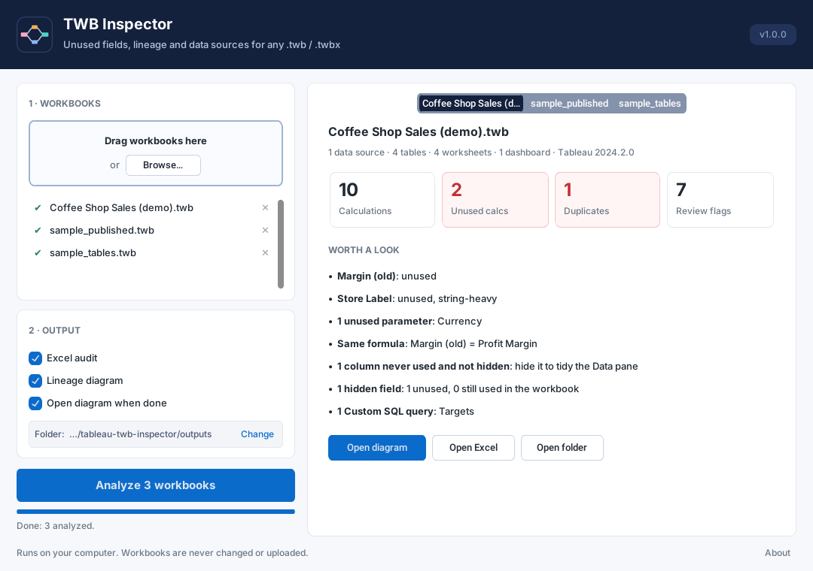
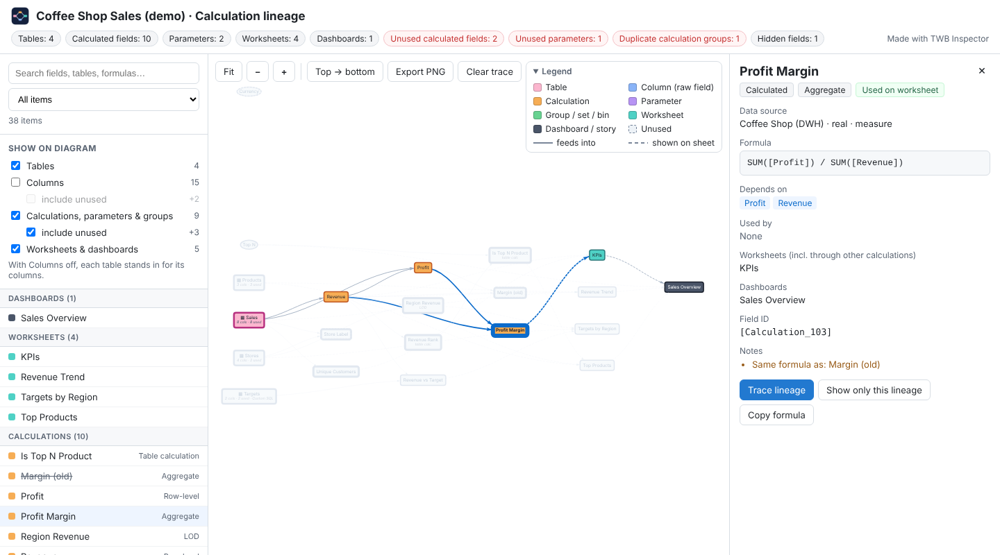

#  TWB Inspector

**Find unused fields, duplicate calculations, calculation lineage and data source tables in any Tableau workbook (`.twb` / `.twbx`). Free, open source, and everything runs on your own computer.**

Inheriting a Tableau dashboard usually means double-clicking fields for an afternoon to work out where a number comes from, with no way to tell what is dead weight. TWB Inspector reads the workbook file and tells you in seconds.



---

## ✨ What it does

- **Unused fields**: calculations, parameters and raw columns that nothing uses, traced through every calculation, worksheet, dashboard and action
- **Lineage**: for every field, what it is built from and everything that depends on it, down to worksheets and dashboards
- **Data sources and tables**: every table each data source reads, with connection (server, database or file), live or extract, joins, relationships and the full Custom SQL text
- **Published data sources**: the data source's name, server, site and project, its logical tables with their physical database names, which column comes from which table, and which calculations are defined on the server rather than in the workbook
- **Hidden fields**: counted, filterable, and taken into account in the advice (an unused field that is already hidden needs no action)
- **Duplicate calculations**: the same formula saved under different names (ignores spacing, case and comments)
- **Review flags**: LOD expressions, table calculations, long or text-heavy formulas, `COUNTD`, `RAWSQL`, deep calculation chains
- **Readable formulas**: internal IDs like `[Calculation_1238…]` replaced by field names
- **Many workbooks at once**: drag in a whole folder

### Outputs

**An interactive lineage diagram** (one HTML file, works offline): tables → fields → calculations → worksheets → dashboards.

- Opens on a clean overview: each table is one box standing in for its columns, so large workbooks stay readable
- **Show on diagram** picks exactly what is drawn: tables, columns, calculations / parameters / groups, worksheets & dashboards, each with an "include unused" option where it applies
- Click any field to see its formula, source table, dependencies and where it's used
- **Trace lineage** highlights everything above and below a field; **Show only this lineage** redraws just that path
- Search highlights matches on the diagram (Enter jumps to the first), filters for unused, hidden, flagged and duplicate fields
- Switch between left-to-right and top-to-bottom, and export the current view as a PNG



**An Excel audit** with one sheet per question:

| Sheet | What it answers |
|---|---|
| Summary | How big is this workbook, and how much is unused or duplicated? |
| Data Sources & Tables | Which tables does each data source read, from where (incl. server / site / project of published sources), and how many of their columns are used? |
| All Fields | Every field with where it's defined (workbook or published source), its source table, readable formula, dependencies, usage status, hidden flag, worksheets and dashboards |
| Unused | What can be removed or hidden, with advice that depends on whether it's hidden and where it's defined |
| Duplicate Calcs | Which calculations have the same formula? |
| Review Flags | Which calculations deserve a second look? |
| Dependencies | Edge list of the lineage (field → calculation → worksheet), for your own analysis |
| Worksheets | Which dashboards each sheet is on, hidden tabs, sheets on no dashboard |

---

## 🚀 Getting started

### Option 1: the Windows app (no Python needed)

Download `TWB_Inspector.exe` from the [Releases](../../releases) page and double-click it.

1. Drag one or more workbooks (or a folder) onto the window, or click **Browse…**
2. Choose the outputs and the output folder
3. Click **Analyze**

Each workbook gets a results tab with the key numbers, a short **Worth a look** list, and buttons to open the diagram, the Excel file or the folder. Your choices are remembered for next time.

> Windows SmartScreen may warn the first time you run a downloaded `.exe` that isn't code-signed. Choose **More info → Run anyway**.

### Option 2: run from source (Windows, macOS, Linux)

Requires Python 3.9 or newer.

```bash
git clone https://github.com/Saina2405/tableau-twb-inspector.git
cd tableau-twb-inspector
pip install -r requirements.txt

python twb_inspector_app.py          # the desktop app
```

### Try it without your own workbook

A small invented workbook is included: [`examples/Coffee Shop Sales (demo).twb`](examples). It has joins, relationships, Custom SQL, an LOD, a table calculation, unused fields and a duplicate, so every feature has something to show.

---

## 🧰 Other ways to use it

### Command line

Handy for batch jobs or scheduled runs.

```bash
python twb_inspector_cli.py                                  # every workbook in inputs/ → outputs/
python twb_inspector_cli.py "Sales.twbx" reports/ -o audit   # files and/or folders, custom output folder
python twb_inspector_cli.py --no-html --no-open              # Excel only, don't open the browser
python twb_inspector_cli.py --help
```

### Jupyter notebook

[`notebooks/explore_workbook.ipynb`](notebooks/explore_workbook.ipynb) explores a workbook in Python. It shows tables and fields as DataFrames, traces the lineage of one field, finds everything that depends on a database column (impact analysis), and compares many workbooks side by side.

```bash
pip install jupyter
jupyter notebook notebooks/explore_workbook.ipynb
```

### As a Python library

```python
from twb_inspector import analyze_workbook, process_workbook

lineage = analyze_workbook("Sales.twbx")
print(lineage.summary())
for field in lineage.unused("Calculated"):
    print(field.name, "=", field.formula_friendly)

process_workbook("Sales.twbx", "outputs")   # writes the Excel audit and the HTML diagram
```

---

## 🔍 How to read the results

### Usage status

| Status | Meaning |
|---|---|
| Used on worksheet | On a shelf, filter, tooltip, title or sort of a worksheet |
| Used on dashboard / action | Shown as a parameter control, or used in an action |
| Used via other calculation | Not placed anywhere itself, but feeds a calculation that is |
| Used only to join tables | Not in any view, but needed as a join or relationship key |
| Used (reported by Tableau) | Tableau lists it as a sheet dependency but the path could not be traced; treat as used |
| Unused | Nothing in the workbook uses it |

Treat **Unused** as a list to review, not a delete list. A workbook file cannot show usage in *other* workbooks that connect to the same published data source, so calculations defined *in* a published data source are reported separately from the workbook's own ("Unused (workbook)" in the app).

### Review flags

| Flag | Why it matters |
|---|---|
| LOD expression / nested LODs | Extra subqueries; nested LODs are a common cause of slow dashboards |
| Table calculation | Computed after the query, on the result set; can be slow with many marks |
| Long formula, many IF/CASE branches | Hard to maintain and often slower |
| String-heavy | Text functions on every row are expensive on large data |
| COUNTD | Distinct counts are among the slowest aggregations |
| RAWSQL / SCRIPT_ | Database-specific SQL or an external service; breaks when moving databases |
| Deep calculation chain | Five or more calculations stacked; hard to follow and debug |
| Same formula as … | Duplicate logic that can drift apart over time |

---

## 🔒 Privacy

- Reads only the workbook's XML: field definitions, formulas, sheet and dashboard structure, connection names
- Never connects to your databases and never reads row-level data, even if the `.twbx` contains an extract
- Never changes the workbook
- No internet needed: the diagram bundles its chart library, so it works offline. Nothing is uploaded anywhere

---

## 🛠 Development

### Project structure

```
tableau-twb-inspector/
├── twb_inspector_app.py        desktop app (customtkinter)
├── twb_inspector_cli.py        command line
├── twb_inspector/              the engine, shared by the app, the CLI and the notebook
│   ├── core.py                 reads the workbook XML, builds the lineage, runs the audit
│   ├── report.py               writes the Excel audit and the HTML diagram
│   ├── excel.py                Excel formatting helper
│   ├── vis-network.min.js      diagram library, bundled for offline use
│   └── assets/                 icon files and make_icon.py that draws them
├── notebooks/                  explore_workbook.ipynb
├── examples/                   demo workbook
├── tests/                      unit tests and small sample workbooks
├── docs/                       screenshots for this README
├── inputs/  outputs/           default folders of the command line
└── twb_inspector.spec          PyInstaller build of the Windows app
```

### Run the tests

```bash
python -m unittest -v
```

### Build the Windows app

```powershell
pip install -r requirements-dev.txt
pyinstaller twb_inspector.spec --clean --noconfirm --workpath "$env:TEMP\pyi_build"
```

The app is written to `dist\TWB_Inspector.exe`. Publish it as an asset of a GitHub Release rather than committing it to the repository. `--workpath` keeps temporary build files out of synced folders such as OneDrive, which otherwise lock them ("Access is denied").

---

## ⚠️ Limitations

- Only what is saved in the workbook file is analysed. For a **published data source**, the workbook stores its logical tables (and their physical names), but not the joins or Custom SQL text inside it; those live on Tableau Server/Cloud.
- Queries Tableau generates at runtime are not stored in the file, so they can't be shown.
- Review flags are static checks on formulas. They point at likely causes of slowness, but don't replace a Tableau performance recording.

## 🗺 Ideas for later

Version comparison between two workbooks · impact analysis in the app · cross-workbook duplicate detection · Tableau Server/Cloud integration · parsing Custom SQL for upstream tables · a Tableau dashboard extension.

## 🙏 Acknowledgments

- Inspired by [tableauCalculationExport](https://github.com/scinana/tableauCalculationExport) by Ana Milana, and grown from [tableau-calculation-lineage-extractor](https://github.com/Saina2405/tableau-calculation-lineage-extractor).
- Diagram rendering by [vis-network](https://visjs.github.io/vis-network/) (Apache-2.0 / MIT).
- Window built with [CustomTkinter](https://github.com/TomSchimansky/CustomTkinter) and [tkinterdnd2](https://github.com/Eliav2/tkinterdnd2).

*Tableau is a trademark of Salesforce, Inc. This project is independent and not affiliated with or endorsed by Tableau or Salesforce.*
